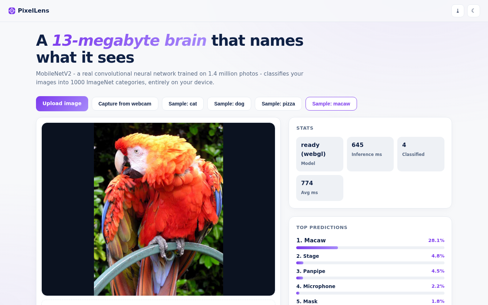
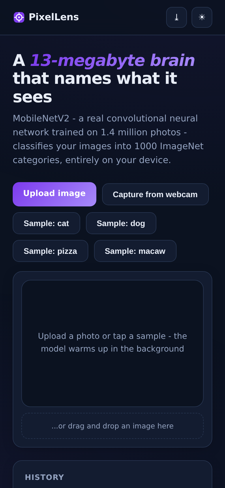

# PixelLens - In-Browser CNN Image Classifier

**A real convolutional neural network - MobileNetV2 trained on 1.4M ImageNet photos - classifies your images into 1000 categories, entirely on your device.** Uploads, drag & drop, webcam capture, classification history. Nothing is uploaded.

**Live demo:** https://akash991833.github.io/image-classifier-cnn/

## Features

- **Real CNN, fully local** - MobileNetV2 1.0 (224), ~14MB of vendored weights, TensorFlow.js with WebGL acceleration (CPU fallback)
- **Smart preprocessing** - images are center-cropped square before inference (aspect-squashing destroys accuracy; fixed and verified)
- **Top-5 predictions** with animated confidence bars
- **Four ways to classify** - file upload, drag & drop, webcam snapshot, bundled samples (cat / dog / pizza / macaw - all verified to hit the right top-1)
- **Queue-safe** - rapid clicks never drop a classification; the latest image is always processed
- **History grid** - last 12 classifications with thumbnails; click to revisit
- **Stats** - backend (webgl/cpu), inference ms, classified count, average ms
- **PWA** - installable; model and app cache for offline use after first load
- **Premium UI** - white professional design, navy ink, violet accent, dark + light themes, responsive desktop and mobile

## Screenshots

## Honest limits

MobileNetV2 knows exactly 1000 ImageNet categories - common animals, foods, vehicles, objects. Anything else gets the nearest-looking label. Best with one centered, well-lit subject. First load downloads ~14MB (cached after). Stated in-app.

## Tech

Vanilla HTML/CSS/JS + TensorFlow.js 4.22 + @tensorflow-models/mobilenet 2.1.1 (all vendored). Sample photos: Wikimedia Commons.

## Run locally

Serve the folder (`python3 -m http.server`) and open `http://localhost:8000` (camera needs localhost or HTTPS).
